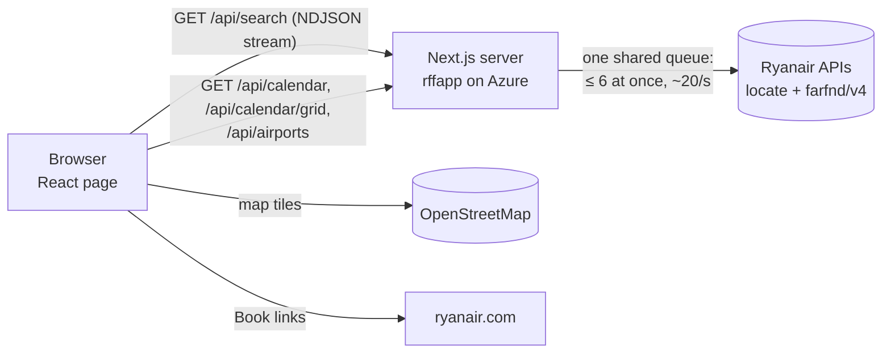

# How RFF works

The technical guide: how a search runs, how RFF protects Ryanair (and itself) from too many requests,
the API, and where things live in the code. For using the site, see [USER_GUIDE.md](USER_GUIDE.md). For
releases and routine upkeep, see [MAINTENANCE.md](MAINTENANCE.md). For the Azure setup, see [../AZURE.md](../AZURE.md).

---

## Contents

1. [Overview](#1-overview)
2. [Ryanair data](#2-ryanair-data)
3. [How a search runs](#3-how-a-search-runs)
4. [Anywhere, calendar and date grid](#4-anywhere-calendar-and-date-grid)
5. [Streaming results to the page](#5-streaming-results-to-the-page)
6. [Protection: caches, queue and limits](#6-protection-caches-queue-and-limits)
7. [API reference](#7-api-reference)
8. [The page: address, storage and components](#8-the-page-address-storage-and-components)
9. [Project layout](#9-project-layout)
10. [Development and tests](#10-development-and-tests)

---

## 1. Overview

| | |
|---|---|
| Framework | Next.js 16 (App Router), React 19, TypeScript |
| Runtime | Node.js 24, as a standalone Next.js server (`output: 'standalone'`) |
| Hosting | Azure App Service `rffapp` (Linux, Basic B2), custom domain `rff.fvcloud.eu` |
| Data | Ryanair's public website APIs, no key. No database: in-memory caches on the server, `localStorage` in the browser |
| Map | Leaflet with OpenStreetMap tiles, loaded only when the map is opened |
| Tests | Vitest unit tests, run in CI on every pull request and before every deploy |



The browser never calls Ryanair's APIs itself. Everything goes through the server, which caches answers and
keeps the total request rate low, because Ryanair blocks addresses that ask too fast.

## 2. Ryanair data

All calls are in `lib/ryanair.ts`.

| What | Ryanair endpoint | Cached |
|---|---|---|
| Active airports (name, city, country, region, coordinates, time zone) | `www.ryanair.com/api/views/locate/5/airports/en/active` | 24 h; an old copy is served if a refresh fails |
| Routes from an airport | `www.ryanair.com/api/views/locate/searchWidget/routes/en/airport/{code}` | 12 h |
| Cheapest fare per day for a whole month, one route | `services-api.ryanair.com/farfnd/v4/oneWayFares/{from}/{to}/cheapestPerDay?outboundMonthOfDate=YYYY-MM-01&currency=EUR` | 15 min |
| Cheapest fare on one day, one route (gives the flight number) | `services-api.ryanair.com/farfnd/v4/oneWayFares?departureAirportIataCode=…&arrivalAirportIataCode=…&outboundDepartureDateFrom=…&outboundDepartureDateTo=…&currency=EUR` | 15 min |
| Cheapest fare to every destination from an airport on one day ("Anywhere") | the same, without `arrivalAirportIataCode` | 15 min |

Important limits of this data:

- **One flight per route per day**: the cheapest. A connection that needs a pricier flight on one leg can be
  missed.
- **Month fares have no flight numbers.** RFF looks them up afterwards from the one-day endpoint, for the 20
  cheapest results only (at most 40 lookups per search).
- Prices are Ryanair's basic fare for one adult in euros.
- These are unofficial website APIs. They can change without notice; the booking link format already changed
  once (see [MAINTENANCE.md](MAINTENANCE.md)).

## 3. How a search runs

Code: `app/api/search/route.ts` → `lib/search.ts` → `lib/finder.ts`.

1. **Validate** (`parseSearchParams`): airport codes, real dates, a return on or after the departure.
   Limits: ±7 flexible days, 40 airports per side, 300 airport-pair × date combinations (Anywhere: 5 origins,
   15 origin × day combinations). Invalid or too broad → 400 with a message saying what to change. (The form
   itself also refuses past dates.)
2. **Expand** flexible dates (`lib/time.ts`, `expandDates`) and list every origin × destination pair.
3. For **each pair**, in parallel (the queue in section 6 keeps the real request rate low):
   - **Direct**: the month fares for the pair (one request per month, then cached) give the cheapest flight on
     each searched day.
   - **One stop**: every airport that both ends fly to is a possible hub (`findHubs`, from the route lists).
     Each leg's fare comes from the month fares. A connection is kept if the wait is **2 to 12 hours**.
   - **Airport changes** (`findAirportChanges`, `lib/mixedAirports.ts`): land at one airport and fly on from
     another in the same city (e.g. Luton → Stansted). The minimum wait becomes 2 h plus the transfer time.
4. **Round trips**: the same is done for the return. Each outbound option is paired with the **5 cheapest**
   returns that leave after it lands (`combineRoundTrips`). When several airports were chosen, returns may also
   leave from another airport in the same city, or land at another home airport within 200 km; those get
   their own slots so they never push out same-airport options, and are badged on the page.
5. Results are **streamed** to the page per pair as they're ready (section 5): direct flights in about 0.2 s,
   connections after.
6. After all pairs are done, **flight numbers** are looked up for the 20 cheapest results and sent as one more
   message. Up to **200** results are kept; the page sorts and filters them itself.

Times are local to each airport. Durations use each airport's time zone (`lib/time.ts`).
Layover badges (`lib/layoverRisk.ts`): *Tight* under 2 h 30 min (plus transfer time), *Long* over 8 h,
*Overnight* when the next flight is on another day.

When a search finds nothing, the page offers ideas (`lib/suggestions.ts`): ±3 flexible days, up to 2 nearby
airports within 250 km, one way instead of a round trip, or Anywhere.

## 4. Anywhere, calendar and date grid

**Anywhere** (`lib/anywhere.ts`): for each origin and day, one request lists the cheapest flight to every
destination (these are also the first legs). Then the same is asked from each of those destinations for the
second legs, and the cheapest way to reach each final destination is kept, plus the cheapest direct one if
different. Round trips look up returns for the 40 cheapest destinations. Limits: 5 origins, 15 origin × day
combinations (about 20 requests per origin and day). Airport changes are not used here.

**Price calendar** (`lib/calendar.ts`, `GET /api/calendar`): the cheapest one-way price per day of a month across
the chosen airport pairs, direct and one-stop. Above 12 airport pairs it shows direct flights only; above 100
pairs it isn't available.

**Date grid** (`GET /api/calendar/grid`): departure ±3 days × return ±3 days, the cheapest round trip per cell,
from two one-way fares paired by the same airport rules as the search. Up to 12 airport pairs; connections are
included up to 4 pairs.

**Lithuanian holidays** (`lib/lithuania.ts`): public holidays are calculated for any year (Easter included).
School breaks and holiday windows are data for the current school year and need updating each year.

## 5. Streaming results to the page

`/api/search` answers with `Content-Type: application/x-ndjson`: one JSON object per line, as soon as it's
ready. A pair can send several `results` messages as connections are found; each replaces the previous one for
that pair, and the last has `"final":true`. The message types are in `lib/events.ts`:

```jsonc
{"type":"results","pair":"VNO-STN","results":[ /* SearchResult[] */ ],"final":false} // replaces earlier results for that pair
{"type":"results","pair":"VNO-STN","results":[ … ],"final":true}
{"type":"complete"}                                                                 // every pair searched
{"type":"flightNumbers","numbers":{"VNO-STN-2026-11-27T06:25:00":"FR2981"}}         // keyed by flightKey(): origin-destination-departure
{"type":"error","error":"Ryanair isn't answering right now, …"}
```

The page reads it with `readEvents()` and shows results as they arrive. If nothing arrives for 60 seconds, the
page stops the search and offers **Try again**.

When the visitor leaves or starts another search, the request is aborted; the server then drops that search's
Ryanair requests that are still waiting in the queue (requests already sent finish and are cached).

## 6. Protection: caches, queue and limits

Ryanair blocks an address that sends too many requests, which would break the site for everyone. So:

| Layer | Where | What it does |
|---|---|---|
| **Caches** | `lib/cache.ts` (`TtlCache`) | Airports 24 h, routes 12 h, fares 15 min. Two searches asking for the same thing at the same time share one request |
| **Shared queue** | `lib/cache.ts` (`createLimiter(6, 50)`) | All Ryanair requests from all visitors: at most 6 at once, started at least 50 ms apart (about 20 a second). Queued requests of an abandoned search are dropped |
| **Timeouts** | `lib/ryanair.ts` | 10 s per request |
| **Pause** | `lib/ryanair.ts` | On HTTP 403 or 429, or when at least 8 of the last 30 s of requests failed (and at least half of them), stop calling Ryanair for 60 s. Searches get "Ryanair isn't answering right now…" and `/api/health` answers 503 |
| **Per-visitor limits** | `lib/rateLimit.ts` | 30 searches/min; 5 Anywhere searches per 10 min; 40 calendar views/min, where a view counts 1 + 1 per 10 airport pairs. Over the limit → HTTP 429 with `Retry-After` |
| **Search size** | `lib/search.ts`, `lib/searchUrl.ts`, `lib/calendar.ts` | The limits in sections 3 and 4 |

**Telling visitors apart** (`clientKey` in `lib/rateLimit.ts`): Azure's front end adds the visitor's address to
`X-Forwarded-For`. RFF uses the right-most public address in that header, which a visitor can't fake. Once per
start it logs which header it used.

## 7. API reference

All endpoints are `GET` and return JSON unless noted. Errors are `{"error":"message"}` with status 400 (bad
input), 429 (too many requests, with `Retry-After`), 500 or 503 (Ryanair unavailable).

### `/api/search`: streamed search

| Parameter | Example | |
|---|---|---|
| `origin` | `VNO` or `VNO,KUN` | Required. Comma-separated airport codes |
| `dest` | `BCN,GRO` or `ANYWHERE` | Required |
| `date` | `2026-11-27` | Required. Departure date |
| `returnDate` | `2026-12-04` | Optional. Makes it a round trip |
| `dateRangeDays`, `dateDirection` | `3`, `both` / `after` / `before` | Optional. Flexible departure |
| `returnDateRange`, `returnDateDirection` | `2`, `both` | Optional. Flexible return |

Response: NDJSON stream (section 5).

### `/api/calendar`: cheapest price per day

`?origin=VNO&dest=BCN&month=2026-11` →
`{"month":"2026-11","days":[{"date":"2026-11-01","price":24.99,"direct":true}, …],"includesConnections":true}`
(`price` is `null` on days with no flights). Cached by browsers for 5 minutes.

### `/api/calendar/grid`: round-trip date grid

`?origin=VNO&dest=STN&date=2026-11-06&returnDate=2026-11-09` →
`{"departures":[…7 dates],"returns":[…7 dates],"prices":[[…]],"includesConnections":true}`
(`prices[i][j]` is the cheapest round trip leaving `departures[i]` and returning `returns[j]`, or `null`).

### `/api/airports`

The list of active Ryanair airports (code, name, city, country, region, coordinates, time zone). Cached on the
server for 24 hours and in browsers for 1 hour.

### `/api/health`

Never calls Ryanair. Example:

```json
{"status":"ok","version":"1ad78db","node":"v24.22.1","builtAt":"…","startedAt":"…","uptimeSeconds":70463,
 "ryanair":{"paused":false,"pausedUntil":null,"unavailable":false,
   "last30s":{"requests":47,"failures":0},"sinceStart":{"requests":739,"failures":0},
   "lastSuccessAt":"…","lastFailure":null}}
```

`version` is the deployed commit. Status 503 with `"status":"paused"` while requests to Ryanair are paused,
so it works with an uptime monitor.

## 8. The page: address, storage and components

### Page address

The whole search and view live in the address (`lib/searchUrl.ts`), so links can be shared and Back/Forward
work. Example: `/?from=VNO&to=BCN,GRO&date=2026-11-13&return=2026-11-20&returnFlex=2&sort=fastest`

| Parameter | Meaning |
|---|---|
| `from`, `to`, `date` | Required. Codes (comma-separated) or `to=ANYWHERE`; departure date |
| `return` | Return date (round trip) |
| `flex`, `flexDir` | Flexible departure days; `after` / `before` (default both) |
| `returnFlex`, `returnFlexDir` | Flexible return days |
| `sort` | `fastest` or `earliest` (default cheapest) |
| `direct=1`, `same=1` | Direct only; same airport only |
| `maxLayover`, `maxPrice` | Hours; euros |
| `show=map` | Anywhere results on the map |

A shared search gets its own link preview title, e.g. "Vilnius → Barcelona · 20 Nov | RFF" (`lib/searchTitle.ts`,
`app/opengraph-image.tsx`). Previews and the canonical address use `https://rff.fvcloud.eu` (override with the
`SITE_URL` environment variable).

### Browser storage (`localStorage`, this device only)

| Key | What | Code |
|---|---|---|
| `recentSearches` | Last 5 searches (3 shown) | `lib/recentSearches.ts` |
| `favouriteRoutes` | Saved routes, up to 10 | `lib/favourites.ts` |
| `theme` | `light` or `dark` when picked with the switch; absent = follow the system | `lib/theme.ts` |

### Components

`components/HomePage.tsx` holds the page together: it reads the address, runs the search stream and renders:

| Component | Part of the page |
|---|---|
| `SearchForm`, `AirportInput`, `SearchSummary` | The form, the airport picker (airports, cities, countries, groups, Anywhere), and the folded one-line form on phones |
| `HomeIntro`, `LogoMark` | Intro line and "Try one" quick starts (`lib/quickStarts.ts`), logo |
| `RecentSearches`, `SavedRoutes`, `HolidayWindows` | Recent searches, saved routes, Lithuanian holiday windows |
| `ResultsToolbar` | Sort and filters (chips on phones) |
| `FlightResults`, `ResultCard` | The result list (20 at a time), compact rows with Book links (`lib/booking.ts`) |
| `AnywhereMap` | Leaflet map for Anywhere, loaded on demand |
| `PriceCalendar`, `DateGrid` | Month view and round-trip grid |
| `ThemeToggle`, `Icon` | Dark mode switch, line icons |

Styling is one stylesheet, `app/globals.css`, with light and dark colours (`[data-theme="dark"]` and a
`prefers-color-scheme` block for visitors who haven't picked a theme). The site is an installable web app
(`app/manifest.ts`, icons in `app/pwa-icons`).

## 9. Project layout

| Path | What it does |
| --- | --- |
| `app/page.tsx`, `app/layout.tsx` | The page, metadata, theme script |
| `app/api/*` | The endpoints in section 7 |
| `lib/ryanair.ts` | Ryanair calls, caches, queue, pause and health status |
| `lib/cache.ts` | `TtlCache` (shared loads, abort-safe) and `createLimiter` |
| `lib/search.ts` | Search validation and limits, flexible dates, round trips, streaming, flight numbers |
| `lib/finder.ts` | Direct and one-stop trips for one airport pair |
| `lib/mixedAirports.ts` | Same-city airports, transfer times, allowed return airports |
| `lib/anywhere.ts` | Anywhere search |
| `lib/calendar.ts` | Price calendar and date grid |
| `lib/rateLimit.ts` | Per-visitor limits and visitor address |
| `lib/events.ts` | Stream message types and reader |
| `lib/airportGroups.ts` | Cities, regions, countries and groups for the picker |
| `lib/lithuania.ts` | Lithuanian holidays, school breaks, holiday windows, leave days |
| `lib/searchUrl.ts`, `lib/useUrl.ts` | Page address ↔ search and view |
| `lib/resultFilters.ts`, `lib/layoverRisk.ts`, `lib/suggestions.ts` | Sorting and filters, layover badges, ideas when nothing is found |
| `lib/booking.ts` | ryanair.com booking links |
| `lib/quickStarts.ts` | Home page quick starts |
| `lib/format.ts`, `lib/time.ts` | Display formats; local time, UTC and dates |
| `lib/recentSearches.ts`, `lib/favourites.ts`, `lib/theme.ts` | Browser storage |
| `lib/types.ts` | `Airport`, `Flight`, `RouteResult`, `SearchResult` |
| `components/` | See section 8 |
| `tests/` | Vitest unit tests |
| `.github/workflows/` | `checks.yml` (pull requests), `main_rffapp.yml` (build and deploy on `main`) |
| `next.config.ts` | Standalone output, security headers, build version for `/api/health` |

## 10. Development and tests

Requires Node.js 24 (what Azure runs).

```bash
npm install
npm run dev          # http://localhost:3000
npm test             # unit tests (Vitest)
npm run lint
npm run typecheck
npm run build        # production build (standalone)
```

The tests cover search limits and validation, one-stop and round-trip pairing, mixed airports, Anywhere,
caching and the request queue, rate limits and visitor addresses, page address round trips, filters, holiday
maths, airport groups, quick starts, booking links and theme logic. They don't call Ryanair.

A local dev server calls the real Ryanair APIs. Test heavy searches (Anywhere, many airports) locally rather
than on the live site: bursts from the live server's address can get it blocked for a while.

Security headers (`next.config.ts`): HSTS, `X-Content-Type-Options: nosniff`, `X-Frame-Options: DENY` /
`frame-ancestors 'none'`, a strict referrer policy and a permissions policy with camera, microphone and location
off. No `X-Powered-By`.
