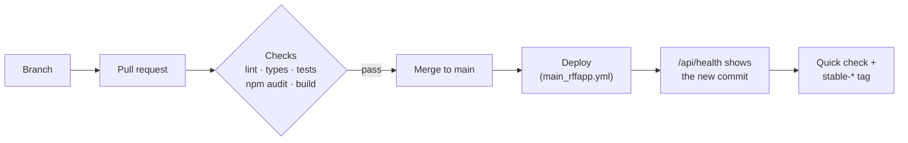

# Maintaining RFF

How changes go live, how to undo them, and the jobs that need doing from time to time. For how the code works,
see [HOW_IT_WORKS.md](HOW_IT_WORKS.md). For the Azure setup and troubleshooting, see [../AZURE.md](../AZURE.md).

---

## Contents

1. [Releasing a change](#1-releasing-a-change)
2. [Checking a release](#2-checking-a-release)
3. [Rolling back](#3-rolling-back)
4. [Calendar of recurring jobs](#4-calendar-of-recurring-jobs)
5. [Common changes](#5-common-changes)
6. [When Ryanair changes something](#6-when-ryanair-changes-something)
7. [Known limitations](#7-known-limitations)

---

## 1. Releasing a change

`main` is what's live: every push to `main` deploys. So all changes go through a pull request.



1. **Branch and pull request.** Make the change on a branch and open a pull request against `main`.
2. **Checks** (`.github/workflows/checks.yml`) run on the pull request: lint, type check, unit tests, a security
   audit of production dependencies (`npm audit --omit=dev --audit-level=high`) and a production build. All
   must pass.
3. **Merge.** Merging to `main` starts the deploy (`.github/workflows/main_rffapp.yml`): the same checks, a
   standalone build, deploy to Azure, then the run waits until `/api/health` reports the new commit (up to
   10 minutes). Deploys run one at a time.
4. **Check** the live site (section 2) and **tag** the release:

   ```bash
   git fetch origin main
   git tag -a stable-2026-11-09 origin/main -m "What went live"
   git push origin stable-2026-11-09
   ```

   Add `-2`, `-3` for more releases on the same day.

Never deploy by hand (`az webapp up`, zip upload): it skips the checks, and the next merge overwrites it.

## 2. Checking a release

Light checks only. Heavy searches (Anywhere, whole countries) from your own computer are fine; repeated
heavy searches against the live site can get its Azure address blocked by Ryanair for a while.

| Check | Expect |
|---|---|
| `https://rff.fvcloud.eu/api/health` | `"status":"ok"`, `version` = the merged commit's first 7 characters, `failures` near 0 |
| `https://rff.fvcloud.eu/` | Page loads |
| `https://rff.fvcloud.eu/api/airports` | About 225 airports |
| One small search, e.g. Vilnius → London on a date a few weeks ahead | Results appear, rows have Book buttons |
| If the change touched booking links | Open one Book link: ryanair.com should show the flight list for that route and date, not an error page |

## 3. Rolling back

**Undo one pull request** (the usual way): open it on GitHub, click **Revert**, then merge the pull request
GitHub creates. That goes through `main`, so the previous version deploys automatically.

**Go back to a known-good version**: tags `stable-YYYY-MM-DD[-N]` mark versions that were checked live. Deploys
must come from `main`, because Azure's login trusts only that branch, so bring the tag's code onto `main`:

```bash
git checkout main && git pull
git checkout stable-2026-11-09 -- .
git commit -m "Restore stable-2026-11-09"
git push            # or open a pull request with this commit
```

Don't run the deploy workflow on the tag itself.

## 4. Calendar of recurring jobs

| When | Job | Where |
|---|---|---|
| **Before June 2027**, then every school year | Add the next school year's **school breaks** and **holiday windows**. The data ends with summer 2027; after that the Holiday windows strip empties and leave/school notes stop marking breaks. Dates come from the official school-year schedule (general education plans) | `lib/lithuania.ts`: `SCHOOL_BREAKS`, `HOLIDAY_WINDOWS` |
| When CI's **Security audit** fails | A dependency has a high or critical advisory. Update it in its own pull request (e.g. `npm install next@latest eslint-config-next@latest`), then update open pull requests from `main` | `package.json`, `package-lock.json` |
| Every few months | Update dependencies generally, run the checks and try the site locally | `package.json` |
| **Before April 2028** | Node.js 24 support ends. Move to the next LTS version in Azure (runtime), both workflows and the docs | Azure `rffapp` settings, `.github/workflows/*.yml` |
| Occasionally | Look at `/api/health` and Azure logs for Ryanair failures or pauses | [../AZURE.md](../AZURE.md) |
| If traffic grows a lot | OpenStreetMap's tile servers are for light use; switch the map to a hosted tile service | `components/AnywhereMap.tsx` |

Public holidays (including Easter) are calculated for any year and need no updating.

## 5. Common changes

**Add or change a destination group** (e.g. "Canary Islands"): edit `VIRTUAL_REGIONS` in `lib/airportGroups.ts`.
A group can list Ryanair region names (`regions`, which pick up new airports in those regions automatically)
and/or airport codes (`airports`, a fixed list; codes Ryanair no longer flies to are skipped). Add
`description`, `icon` and search `keywords` if useful. Keep a group to about 25 airports: a search allows 40 per
side. Add a test in `tests/airportGroups.test.ts`.

**Add a same-city airport pair or change a transfer time** (e.g. Luton ↔ Stansted): `TRANSFER_MINUTES` in
`lib/mixedAirports.ts`.

**Change search limits**: `lib/search.ts` (flexible days, airports per side, combinations, results kept). The
quick starts keep a copy of these numbers in `lib/quickStarts.ts`; `tests/quickStarts.test.ts` fails if they
differ. Anywhere limits are in `lib/searchUrl.ts`; calendar limits in `lib/calendar.ts`.

**Change per-visitor limits**: `app/api/search/route.ts` (searches, Anywhere) and `lib/calendar.ts` (calendar).
Mention new numbers in [USER_GUIDE.md](USER_GUIDE.md) and [HOW_IT_WORKS.md](HOW_IT_WORKS.md).

**Change how many results the page shows at once**: `PAGE_SIZE` in `components/FlightResults.tsx`.

**Update the docs** whenever a change is visible to visitors (user guide) or changes limits, endpoints or files
(how it works).

## 6. When Ryanair changes something

RFF depends on Ryanair's unofficial website APIs and booking pages.

| Symptom | Likely cause | Where to look |
|---|---|---|
| Book links open a Ryanair error page or the home page | Ryanair changed its booking address. In November 2026 `/en/en/` started answering 404; `/gb/en/trip/flights/select` with the full parameter set works | `lib/booking.ts`, `tests/booking.test.ts`. Check a link in a real browser |
| Searches say "Ryanair isn't answering"; `/api/health` shows `"paused"` or many failures | Ryanair is refusing requests from the server's address (too many requests), or the API is down | Azure logs. If it keeps happening, lower the rate in `lib/ryanair.ts` (`createLimiter(6, 50)`) |
| No results anywhere, failures say "not JSON" | Ryanair answered with a bot-check page instead of data | Usually temporary; see above |
| The airport list is empty or old | The airports endpoint changed or failed (an old copy is served for a while) | `getAirports` in `lib/ryanair.ts` |
| Prices or times look wrong | A response field changed | Types and parsing in `lib/ryanair.ts` |

## 7. Known limitations

- Only the cheapest flight per route per day is known, so some connections are missed (see
  [HOW_IT_WORKS.md](HOW_IT_WORKS.md#2-ryanair-data)).
- Groups built from fixed airport lists (e.g. "South of Europe", "Ski & Alps") don't include airports Ryanair
  adds later; review them now and then.
- Server caches and per-visitor limits live in memory: a restart or deploy clears them, and they assume one
  server instance. Scaling out to several instances would need a shared store.
- Prices are cached for up to 15 minutes, so they can differ slightly from ryanair.com.
